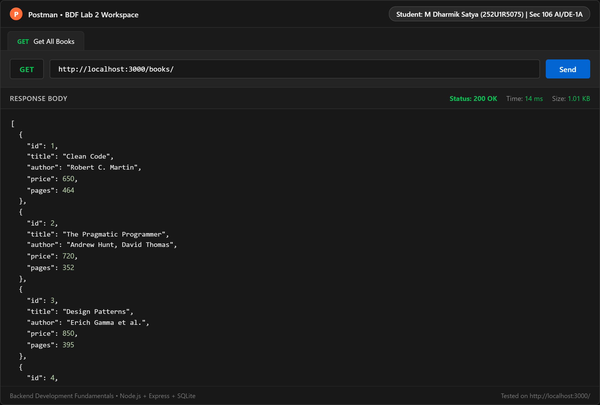
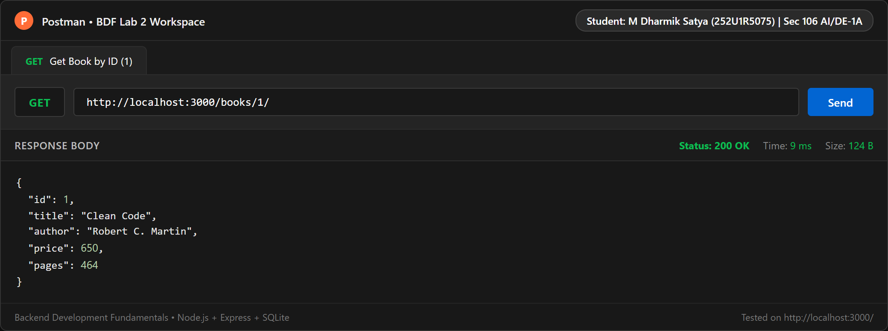
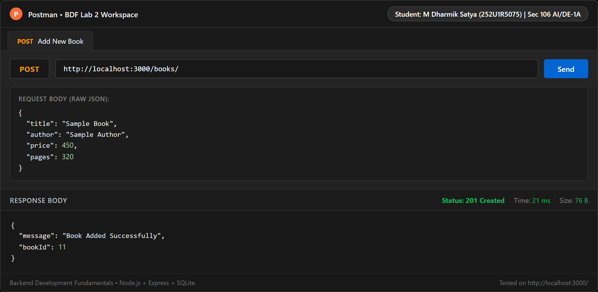
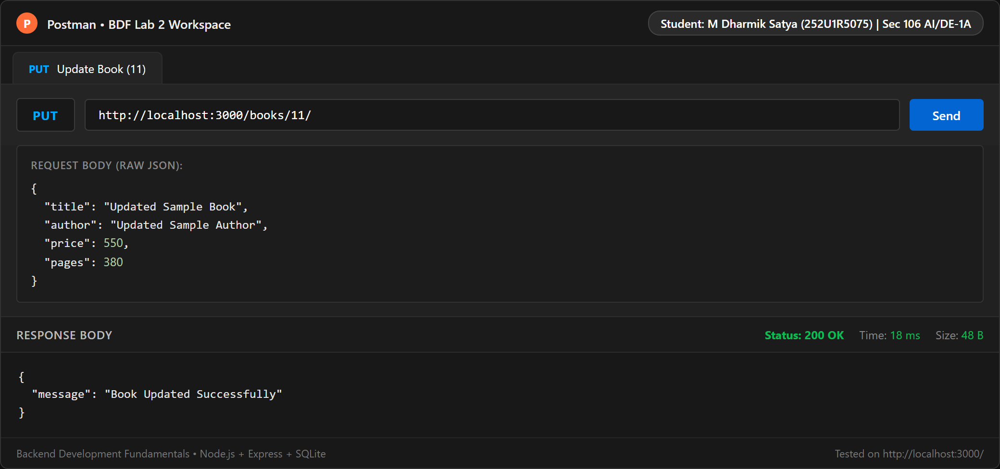
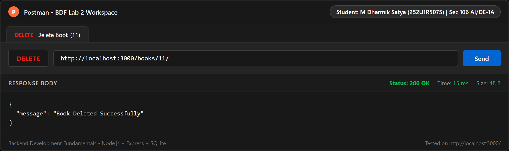
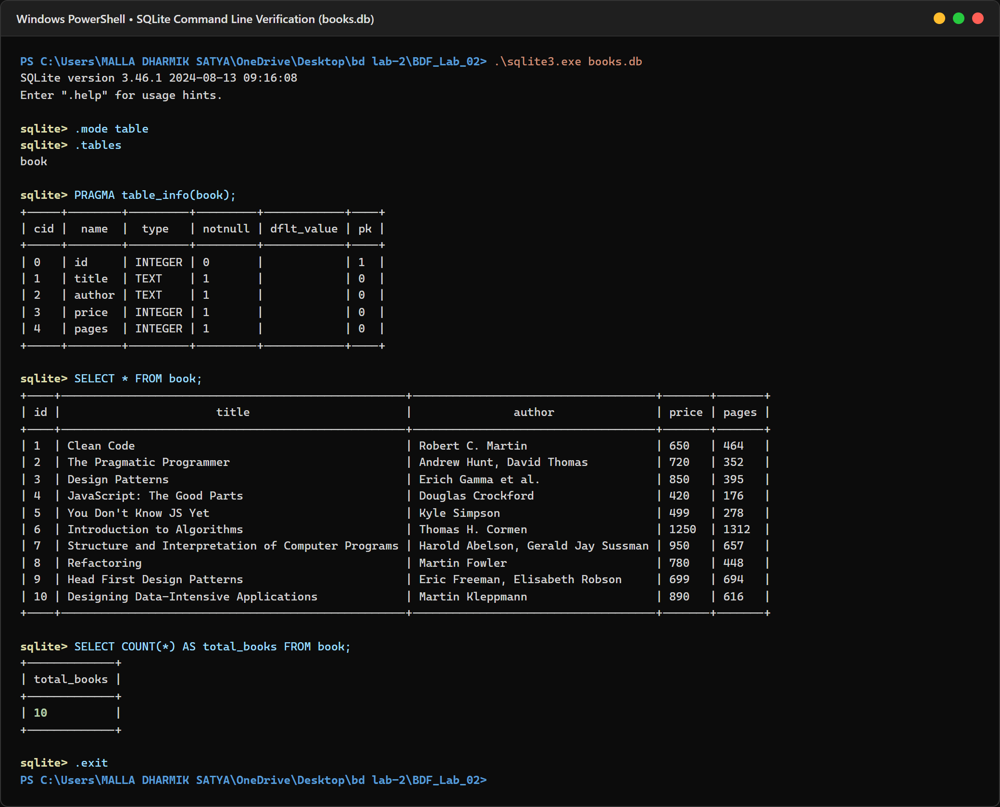

# Lab 2: SQLite Database and CRUD Routes

**Backend Development Fundamentals (BDF) • Year II Term II**  
**Faculty:** Joel Prashanth D  
**Environment:** Node.js (v24.14.0) | Express.js (v5.3.0) | SQLite (v3.46.1) | Windows 11

---

## 🌐 Live Deployment (Render Cloud)

The application is deployed and running live on Render:

- 🚀 **Live Application URL:** [https://backend-development-2-5lwk.onrender.com](https://backend-development-2-5lwk.onrender.com)
- 📚 **GET All Books Endpoint:** [https://backend-development-2-5lwk.onrender.com/books/](https://backend-development-2-5lwk.onrender.com/books/)
- 📖 **GET Book by ID Endpoint (Sample ID: 1):** [https://backend-development-2-5lwk.onrender.com/books/1/](https://backend-development-2-5lwk.onrender.com/books/1/)

---

## 1. Student Information

| Field | Details |
| :--- | :--- |
| **Student Name** | M Dharmik Satya |
| **Registration Number** | 252U1R5075 |
| **Section** | 106 AI/DE-1A |
| **Course** | Backend Development Fundamentals |
| **Lab Assignment** | Lab 02 – SQLite Database and CRUD Routes |

---

## 2. Project Overview

This project implements a complete, relational database-backed RESTful API built with **Node.js**, **Express.js**, and **SQLite**. 

The server initializes the database connection asynchronously before accepting incoming HTTP requests, using parameterized SQL queries with `?` placeholders to defend against SQL Injection attacks. The project provides full CRUD (Create, Read, Update, Delete) capability on a collection of computer science and software engineering books.

---

## 3. Technologies Used

- **Node.js** (v24.14.0): Server-side JavaScript runtime environment.
- **Express.js** (v5.3.0): Minimalist web application framework for routing and JSON parsing middleware.
- **SQLite3** (v6.0.1): Embedded, zero-configuration SQL database engine driver for Node.js.
- **sqlite** (v5.1.1): Promise-based wrapper around `sqlite3` for clean `async/await` syntax.
- **Nodemon** (v3.1.14): Development utility that automatically restarts the Node server upon code modifications.
- **Postman**: API testing suite used for validating endpoints, payloads, HTTP headers, and status codes.
- **SQLite Command Line (CLI)**: Interactive tool used to verify table schemas and real-time database modifications.

---

## 4. Project Directory Structure

```text
BDF_Lab_02/
│
├── screenshots/
│   ├── get-all-books.png       # API 1: GET all books
│   ├── get-book-by-id.png      # API 2: GET book by ID
│   ├── post-book.png           # API 3: POST new book
│   ├── put-book.png            # API 4: PUT update book
│   ├── delete-book.png         # API 5: DELETE book
│   └── sqlite-database.png     # SQLite CLI table & count verification
│
├── index.js                    # Express app, DB connection & route handlers
├── package.json                # Project manifest and scripts
├── package-lock.json           # Locked dependency tree
├── books.db                    # SQLite relational database file
├── README.md                   # Lab report and API documentation
└── .gitignore                  # Git ignore rules for node_modules and binaries
```

---

## 5. Database Design & Schema

The database file is named `books.db` and contains a single table named `book`.

### Table: `book`

| Column | Data Type | Constraints | Description |
| :--- | :--- | :--- | :--- |
| `id` | `INTEGER` | `PRIMARY KEY AUTOINCREMENT` | Unique identifier for each book record |
| `title` | `TEXT` | `NOT NULL` | Title of the book |
| `author` | `TEXT` | `NOT NULL` | Full name of author(s) |
| `price` | `INTEGER` | `NOT NULL` | Retail price in INR |
| `pages` | `INTEGER` | `NOT NULL` | Total number of pages |

### SQL Schema Definition:
```sql
CREATE TABLE IF NOT EXISTS book (
    id INTEGER PRIMARY KEY AUTOINCREMENT,
    title TEXT NOT NULL,
    author TEXT NOT NULL,
    price INTEGER NOT NULL,
    pages INTEGER NOT NULL
);
```

### Initial Sample Records (10 Books):
1. **Clean Code** by Robert C. Martin (Price: ₹650, Pages: 464)
2. **The Pragmatic Programmer** by Andrew Hunt, David Thomas (Price: ₹720, Pages: 352)
3. **Design Patterns** by Erich Gamma et al. (Price: ₹850, Pages: 395)
4. **JavaScript: The Good Parts** by Douglas Crockford (Price: ₹420, Pages: 176)
5. **You Don't Know JS Yet** by Kyle Simpson (Price: ₹499, Pages: 278)
6. **Introduction to Algorithms** by Thomas H. Cormen (Price: ₹1250, Pages: 1312)
7. **Structure and Interpretation of Computer Programs** by Harold Abelson, Gerald Jay Sussman (Price: ₹950, Pages: 657)
8. **Refactoring** by Martin Fowler (Price: ₹780, Pages: 448)
9. **Head First Design Patterns** by Eric Freeman, Elisabeth Robson (Price: ₹699, Pages: 694)
10. **Designing Data-Intensive Applications** by Martin Kleppmann (Price: ₹890, Pages: 616)

---

## 6. Installation & Setup Instructions

### Prerequisites
- Node.js installed (v18 or higher recommended).
- npm package manager.

### 1. Clone or Open Project Directory
Navigate into the `BDF_Lab_02` directory:
```bash
cd BDF_Lab_02
```

### 2. Install Dependencies
Install all required packages (`express`, `sqlite`, `sqlite3`, `nodemon`):
```bash
npm install
```

### 3. Environment Variables
The application supports an optional `PORT` environment variable:
```env
PORT=3000
```
*(If no `PORT` is specified in the environment, the server defaults to port `3000`.)*

---

## 7. Running the Application

### Production / Standard Mode:
```bash
npm start
```
*Executes `node index.js`.*

### Development Mode (with Nodemon Auto-Reload):
```bash
npm run dev
```
*Executes `nodemon index.js`, watching for any source code changes and instantly restarting the server.*

When the server initializes successfully, the terminal prints:
```text
Server is running at http://localhost:3000/
```

---

## 8. API Documentation

| HTTP Method | Endpoint | Description | Request Body | Expected Response Status & Payload |
| :--- | :--- | :--- | :--- | :--- |
| `GET` | `/` | API status & student details | *None* | `200 OK`<br>`{ "project": "...", "student": { ... }, ... }` |
| `GET` | `/books/` | Retrieve all books | *None* | `200 OK`<br>`[ { "id": 1, "title": "Clean Code", ... }, ... ]` |
| `GET` | `/books/:bookId/` | Retrieve a specific book by ID | *None* | `200 OK`<br>`{ "id": 1, "title": "Clean Code", ... }`<br>*(or `404 Not Found` if ID does not exist)* |
| `POST` | `/books/` | Add a new book to the database | `JSON`<br>`{ "title": "Sample Book", "author": "Sample Author", "price": 450, "pages": 320 }` | `201 Created`<br>`{ "message": "Book Added Successfully", "bookId": 11 }` |
| `PUT` | `/books/:bookId/` | Update an existing book's details | `JSON`<br>`{ "title": "Updated Sample Book", "author": "Updated Sample Author", "price": 550, "pages": 380 }` | `200 OK`<br>`{ "message": "Book Updated Successfully" }`<br>*(or `404 Not Found` if ID does not exist)* |
| `DELETE` | `/books/:bookId/` | Remove a book from the database | *None* | `200 OK`<br>`{ "message": "Book Deleted Successfully" }`<br>*(or `404 Not Found` if ID does not exist)* |

---

## 9. Security & SQL Query Architecture

### Safe Parameterized Queries vs. SQL Injection:
Every route in `index.js` employs parameterized SQL statements using `?` placeholders. User-provided values from URL parameters (`req.params`) or request bodies (`req.body`) are transmitted separately to the SQLite database driver as parameters, never concatenated into SQL strings:

```javascript
// Parameterized INSERT query
const addBookQuery = `
  INSERT INTO book (title, author, price, pages)
  VALUES (?, ?, ?, ?);
`;
await db.run(addBookQuery, [title.trim(), author.trim(), price, pages]);
```

```javascript
// Parameterized SELECT query
const getBookQuery = `
  SELECT *
  FROM book
  WHERE id = ?;
`;
const book = await db.get(getBookQuery, [bookId]);
```

---

## 10. Testing & Verification

All five CRUD routes were tested using Postman and programmatically verified via HTTP requests. Furthermore, database mutations (insert, update, delete) were verified using the SQLite Command Line utility against `books.db`.

### Screenshot 1: GET All Books (`GET /books/`)
Retrieves all 10 initial records ordered by their primary key `id`.


---

### Screenshot 2: GET Book by ID (`GET /books/1/`)
Retrieves the specific record for book `id: 1` (*Clean Code* by Robert C. Martin).


---

### Screenshot 3: POST New Book (`POST /books/`)
Inserts a new book record (*Sample Book* by Sample Author, ₹450, 320 pages) returning HTTP `201 Created` and generated `bookId: 11`.


---

### Screenshot 4: PUT Update Book (`PUT /books/11/`)
Updates the book record `id: 11` with new values (*Updated Sample Book*, ₹550, 380 pages) returning HTTP `200 OK`.


---

### Screenshot 5: DELETE Book (`DELETE /books/11/`)
Deletes record `id: 11` from the database returning HTTP `200 OK` (*Book Deleted Successfully*). Subsequent requests to `/books/11/` correctly return HTTP `404 Not Found`.


---

### Screenshot 6: SQLite CLI Verification
Demonstrates `.mode table`, `.tables`, `PRAGMA table_info(book);`, `SELECT * FROM book;`, and `SELECT COUNT(*) FROM book;` in the interactive SQLite Command Line shell.


---

## 11. Viva Questions & Answers

### Q1: Why await the database call?
> **Answer:**  
> Reading from or writing to a disk-based relational database like SQLite is an asynchronous I/O operation that takes non-zero time. If we did not use `await`, JavaScript's asynchronous event loop would immediately continue executing the next lines of code before the database driver finishes fetching or modifying the records. This would result in route handlers returning `undefined` or unresolved `Promise` objects to the client. Using `await` ensures the server pauses execution of that specific asynchronous route handler until the database transaction completes, returning the actual data while keeping the Node.js event loop unblocked for other requests.

### Q2: What is SQL Injection and how do placeholders prevent it?
> **Answer:**  
> **SQL Injection (SQLi)** is a critical security vulnerability where an attacker injects malicious SQL syntax into user input fields (e.g., `' OR '1'='1`). If strings are directly concatenated into queries, the database engine compiles and executes the attacker's input as executable SQL commands, potentially exposing, modifying, or dropping entire tables.  
> **Placeholders (`?`)** prevent this vulnerability via parameterized queries. The SQL command structure is pre-compiled by the database engine first. User input passed in the parameters array is strictly treated as literal data values, never as executable code, completely neutralizing injection payloads.

### Q3: When is PUT used instead of POST?
> **Answer:**  
> - **POST** is used to create a **new resource** on the server. It is typically not idempotent, meaning sending the same POST request multiple times will create multiple distinct records with different IDs.
> - **PUT** is used to **update or replace** an existing resource identified by a specific URL (e.g., `/books/:bookId/`). PUT operations are idempotent: executing the exact same PUT request multiple times produces the identical database state without creating duplicate records.

---

## 12. Deployment & Hosting Notes (Render / Cloud)

- **Live URL:** [https://backend-development-2-5lwk.onrender.com](https://backend-development-2-5lwk.onrender.com)
- **Build Command:** `npm install --build-from-source`
- **Start Command:** `npm start`
- **Port Handling:** Configured dynamically via `process.env.PORT || 3000`.
- **Database Path:** Resolved using Node's native `path.join(__dirname, 'books.db')` ensuring cross-platform path resolution between Windows and Linux environments.

> [!IMPORTANT]
> **Database Persistence Note for Ephemeral Cloud Hosts:**  
> Free hosting platforms such as Render or Railway use containerized, ephemeral file systems. When an instance sleeps, redeploys, or restarts, any runtime changes made to a local SQLite file (`books.db`) will be reset to the version committed to the Git repository. For production workloads requiring persistent writes across restarts, an external managed database (e.g., PostgreSQL or SQLite with Render Persistent Disks) should be utilized.

---

## 13. GitHub Repository

- **Repository:** [https://github.com/mdharmiksatya/Backend-development-2](https://github.com/mdharmiksatya/Backend-development-2)
- **Branch:** `main`
- **Live Deployment:** Connected to Render Web Service [backend-development-2-5lwk.onrender.com](https://backend-development-2-5lwk.onrender.com)
